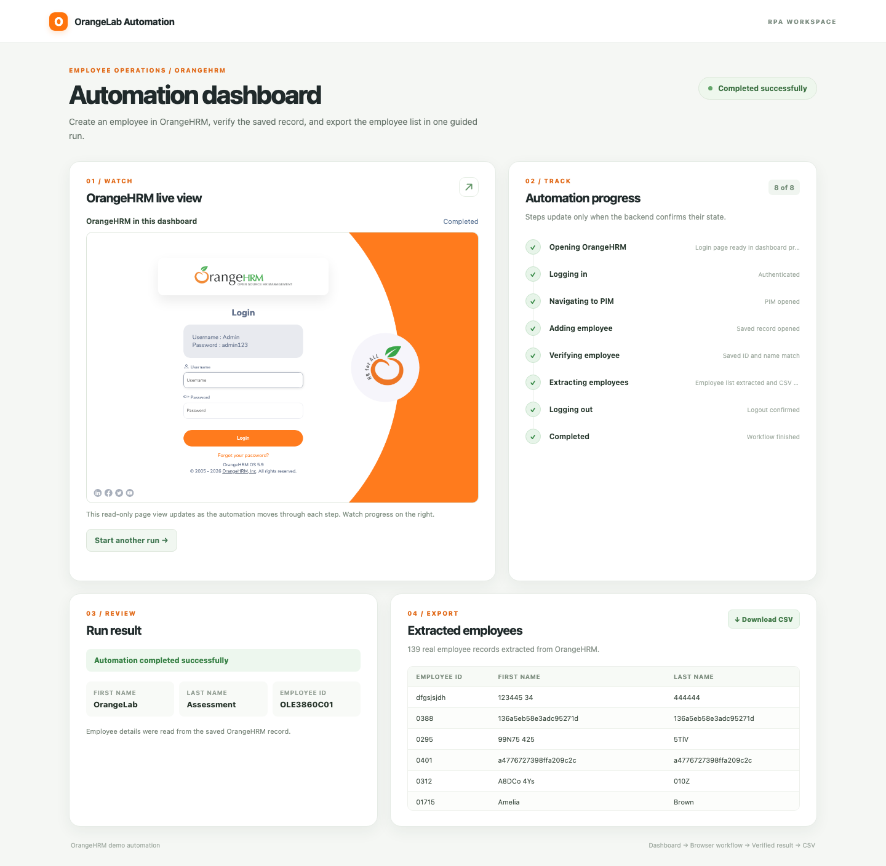

# OrangeHRM Automation Dashboard

A dashboard-driven Python RPA project for OrangeHRM. The dashboard collects credentials and employee details, then runs a Playwright workflow to create and verify the employee, extract the PIM list, and export a CSV. The user stays on the dashboard while a read-only view of the OrangeHRM browser and live step status appear side by side.



## Quick start

**Requirements:** Python 3.11+, internet access, and Playwright Chromium. The project was verified with Python 3.13.13.

```bash
python3 -m venv .venv
source .venv/bin/activate
python -m pip install -r requirements.txt
python -m playwright install chromium
python -m uvicorn app.main:app --host 127.0.0.1 --port 8000
```

Open <http://127.0.0.1:8000/>. On Windows, activate with `.venv\Scripts\activate` and use `python` for the remaining commands. Run one Uvicorn worker because job state is kept in the server process.

Enter the assignment's public-demo credentials (`Admin` / `admin123`) in the dashboard, then enter a first name, last name, and **unique** employee ID (up to 10 characters). Select **Run automation**. The dashboard shows the browser view on the left and confirmed step progress on the right. A successful run shows the verified employee, extracted rows, and **Download CSV**. A failed run shows the reason and a suggested next action. **Start another run** returns to the form.

The automation opens OrangeHRM in its own headless Chromium context. The page images in the dashboard are read-only; the user's dashboard tab remains open throughout the run. Credentials are supplied at runtime, never hardcoded in the automation.

## Evidence and download

- [Download the source and evidence ZIP](OrangeHRM_RPA_Dashboard.zip), including code, tests, screenshots, and the final CSV.
- [Before](screenshots/dashboard_before.png) and [after](screenshots/dashboard_after.png) screenshots come from the same successful run. The password is masked and then cleared.
- Additional screenshots: [live browser view](screenshots/dashboard_live_preview.png), [invalid login](screenshots/dashboard_invalid_login.png), [duplicate ID](screenshots/dashboard_duplicate_id.png), and [mobile layout](screenshots/dashboard_mobile.png).
- [Final extracted CSV](exports/5486454a8552475a8690fbf3e4739099.csv): 139 PIM rows, including the verified employee `OLE3860C01 / OrangeLab Assessment`.

The final dashboard-triggered run on **30 October 2026** passed all eight steps, including logout. The CSV downloaded through the dashboard matched the saved file byte-for-byte. The extractor checked the PIM list count and required the verified employee ID before offering the CSV.

## What the workflow does

1. Validate the five dashboard fields and start one background job.
2. Open the public OrangeHRM demo and log in with the entered credentials.
3. Open PIM, check that the employee ID is not already present, and add the employee.
4. Read back the saved Personal Details page and compare the ID and names with the submitted values.
5. Follow the PIM **Next** control through every page, check the displayed list count, and export the rows to CSV.
6. Log out and close the isolated browser context.

Each stage is logged and reported to the dashboard. A failed stage reports a safe reason and next action. If extraction or logout fails after creation was verified, the dashboard retains the verified employee and marks the run **partial**. It never retries an uncertain Save automatically; check PIM before reusing an ID after a failure.

## Project structure

| Area | Location | Purpose |
| --- | --- | --- |
| Dashboard | `app/templates/index.html`, `app/static/` | Form, step states, read-only browser view, errors, and results |
| API and jobs | `app/main.py`, `app/jobs.py`, `app/schemas.py` | Validation, job isolation, status, preview, and CSV endpoints |
| RPA | `app/services/automation.py` | Playwright workflow, waits, verification, pagination, and logout |
| CSV | `app/services/employee_export.py` | UTF-8 CSV export |
| Tests and live checks | `tests/`, `scripts/` | Deterministic tests and browser-based evidence checks |

The app permits one active job per server process, preventing overlapping edits to the shared demo. Job and preview state are in memory and disappear on restart; CSV files remain in `exports/`. Passwords are absent from stored job state, responses, logs, and screenshots, and the form clears the password after submission.

### API

- `POST /api/automation/run` accepts `username`, `password`, `first_name`, `last_name`, and `employee_id`; it returns HTTP 202 and a job ID.
- `GET /api/automation/{job_id}/status` returns per-step states, verified employee data, extracted rows, and `preview_version`.
- `GET /api/automation/{job_id}/preview` returns the latest PNG page view (HTTP 409 until ready).
- `GET /api/automation/{job_id}/export` downloads UTF-8 CSV with a BOM.

Invalid input returns HTTP 422; a concurrent run returns HTTP 409.

## Tests

```bash
python -m pytest -q
python -m ruff check app tests scripts
python -m ruff check --select I app tests scripts
python -m ruff format --check app tests scripts
```

If Node.js is installed, check the dashboard JavaScript syntax with `node --check app/static/js/dashboard.js`.

To repeat the browser checks, keep the server running in one terminal and run these in another. `capture_evidence.py` creates one real employee in the public demo; the other scripts do not create employees. Set `DASHBOARD_URL` if the server uses another port.

```bash
ORANGEHRM_USERNAME=Admin ORANGEHRM_PASSWORD=admin123 python scripts/capture_evidence.py
python scripts/check_invalid_login.py
ORANGEHRM_USERNAME=Admin ORANGEHRM_PASSWORD=admin123 EXISTING_EMPLOYEE_ID=01715 python scripts/check_duplicate_id.py
python scripts/check_dashboard_ui.py
```

On 30 October 2026, **13 pytest tests passed**, Ruff lint/import order/format and JavaScript syntax passed, and the live successful, invalid-login, duplicate-ID, and 390 px mobile checks passed. Pytest emitted one Starlette/httpx dependency deprecation warning.

## Scope and troubleshooting

The public OrangeHRM demo is shared and can change or reset. This CSV is a UI snapshot, and the locators target the OrangeHRM OS 5.9 interface observed during review. The scanner stops with a visible error after 100 pages rather than silently truncating the export. In the source PIM table, **First (& Middle) Name** maps to CSV **First Name**, and blank source IDs remain blank.

If Chromium cannot launch, run `python -m playwright install chromium` in the same environment as Uvicorn. If port 8000 is occupied, choose another port and open its URL. For a production HR deployment, add authentication, durable jobs, a queue, access controls, retention rules, and selector monitoring.
